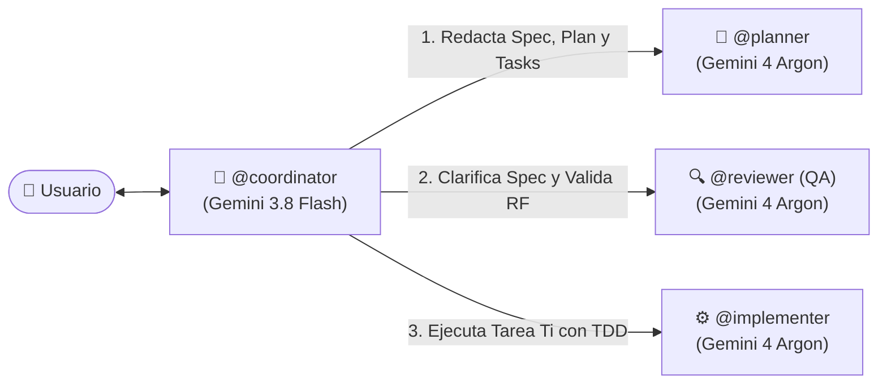

# 🚀 SDD Multiagent Kit (`init-sdd`)

> **ES:** Inicializador de proyectos con **Spec-Driven Development (SDD)**, entrevista interactiva estilo **Grill-Me** y arquitectura multiagente balanceada por potencia de modelos para **OpenCode**, **Antigravity**, **Claude Code** y **Cursor**.
>
> **EN:** Project bootstrapper using **Spec-Driven Development (SDD)**, interactive **Grill-Me** decision-tree interviews, and a power-balanced multi-agent system for **OpenCode**, **Antigravity**, **Claude Code**, and **Cursor**.

---

## 🇪🇸 Guía en Español

### ¿Qué hace este kit?

Cuando empiezas un proyecto desde cero, configurar las reglas de arquitectura, la memoria del proyecto y un equipo de agentes especializados lleva tiempo. **`sdd-multiagent-kit`** añade el comando `/init-sdd`, el agente `@bootstrapper` y la skill `init-sdd` a tu entorno global para que, a partir de una simple idea:

1. **Te entreviste con el método *Grill-Me*** (en rondas de preguntas numeradas con recomendaciones listas para aceptar con un *"sí"*).
2. **Genere automáticamente toda la infraestructura SDD a medida de tu stack:**
   - `docs/constitution.md` — Leyes de negocio, estructura de carpetas, nomenclatura, testing y restricciones (`❌` / `✅`).
   - `AGENTS.md` — Documentación de roles, flujo SDD y comandos reales de validación de tu proyecto.
   - `MEMORY.md` — Bitácora viva con las decisiones arquitectónicas y el roadmap inicial.
   - `opencode.jsonc` — Configuración lista con el agente coordinador por defecto.
   - `.opencode/agents/` — Los **4 agentes SDD** configurados con permisos estrictos y modelos asignados según la potencia que requiere su rol:
     - **`coordinator`** (`google/gemini-3.8-flash#high`): Rápido y ligero. Habla contigo y orquesta a los subagentes sin tocar código.
     - **`planner`** (`google/gemini-4-argon#high`): Máximo razonamiento. Redacta `spec.md` (formato EARS), `plan.md` y `tasks.md`.
     - **`implementer`** (`google/gemini-4-argon#high`): Máxima potencia de código. Ejecuta **1 tarea a la vez** con TDD estricto (tests primero en rojo $\rightarrow$ código en verde).
     - **`reviewer`** (`google/gemini-4-argon#high`): Auditor QA implacable. Detecta ambigüedades en la spec y verifica la implementación RF por RF sobre `git diff`.
3. **Opcionalmente cree el scaffolding inicial del proyecto** y la primera especificación (`specs/001-.../spec.md`).

---

### ⚡ Instalación en 1 paso

#### Opción A: Instalador completo (Recomendado para OpenCode + Antigravity)
Instala la skill global `init-sdd`, el agente `@bootstrapper` y el comando `/init-sdd`:

```bash
curl -fsSL https://raw.githubusercontent.com/Ivan-olivera-dev/sdd-multiagent-kit/main/install.sh | bash
```

O clonando el repositorio:

```bash
git clone https://github.com/Ivan-olivera-dev/sdd-multiagent-kit.git
cd sdd-multiagent-kit
chmod +x install.sh && ./install.sh
```

#### Opción B: Mediante `npx skills` (Ecosistema estándar Agent Skills)
Si solo quieres instalar la skill `init-sdd` mediante el gestor oficial de skills:

```bash
npx skills add Ivan-olivera-dev/sdd-multiagent-kit -g
```

---

### 🛠️ Cómo usarlo en un proyecto nuevo

1. Crea la carpeta de tu proyecto y abre **OpenCode**:
   ```bash
   mkdir mi-nuevo-proyecto && cd mi-nuevo-proyecto
   git init
   opencode
   ```
2. Ejecuta el comando `/init-sdd` describiendo tu idea:
   ```text
   /init-sdd Quiero crear una plataforma de gestión de inventario con Next.js, SQLite y Drizzle
   ```
   *(En Antigravity, Claude Code o Cursor: `"Usa la skill init-sdd para inicializar este proyecto..."`)*
3. Responde a las rondas de preguntas del *Grill-Me* (puedes responder `"sí a todo"` si estás de acuerdo con las recomendaciones `➡️`).
4. Una vez generados los archivos, cambia al agente **`coordinator`** y empieza a construir features con calidad garantizada.

---

### 🔄 Flujo de Trabajo SDD Generado



---

## 🇬🇧 English Guide

### What is this kit?

**`sdd-multiagent-kit`** is a zero-friction bootstrapper for **Spec-Driven Development (SDD)**. Instead of writing boilerplate agent rules or generic `.cursorrules`, it interviews you using a structured **Grill-Me decision tree** and generates a complete, project-specific multi-agent system tailored to your exact tech stack and test runner:

- **`docs/constitution.md`**: Domain rules, directory tree, naming conventions, test strategy, and hard constraints (`❌` / `✅`).
- **`AGENTS.md` & `MEMORY.md`**: Living project memory and multi-agent operating manual.
- **`.opencode/agents/`**: Four specialized agents with strict permissions and power-matched models:
  - `@coordinator` (`google/gemini-3.8-flash#high`) — Fast conversational orchestrator.
  - `@planner` (`google/gemini-4-argon#high`) — Deep-reasoning architect for EARS `spec.md`, `plan.md`, and atomic `tasks.md`.
  - `@implementer` (`google/gemini-4-argon#high`) — TDD-first coder executing one task at a time.
  - `@reviewer` (`google/gemini-4-argon#high`) — Read-only QA auditor validating requirements against `git diff` and test results.

### ⚡ One-Line Installation

```bash
curl -fsSL https://raw.githubusercontent.com/Ivan-olivera-dev/sdd-multiagent-kit/main/install.sh | bash
```

Or via `npx skills`:

```bash
npx skills add Ivan-olivera-dev/sdd-multiagent-kit -g
```

### 🛠️ Usage

Inside any new project folder, open OpenCode and run:

```text
/init-sdd I want to build a local-first habit tracker with React, Express, and SQLite
```

---

## 📁 Estructura del Repositorio / Repository Structure

```text
sdd-multiagent-kit/
├── skills/
│   └── init-sdd/
│       └── SKILL.md                 # Skill compatible con npx skills, OpenCode y Antigravity
├── opencode/
│   ├── agents/
│   │   └── bootstrapper.md          # Agente global @bootstrapper (Gemini 4 Argon)
│   └── commands/
│       └── init-sdd.md              # Comando global /init-sdd para OpenCode
├── index.json                       # Catálogo HTTP nativo para OpenCode V2
├── install.sh                       # Instalador automático en 1 línea
├── uninstall.sh                     # Desinstalador limpio
├── LICENSE                          # Licencia MIT
└── README.md                        # Documentación bilingüe (ES/EN)
```

## 📄 Licencia / License

MIT © [Iván Olivera González (Ivan-olivera-dev)](https://github.com/Ivan-olivera-dev)
